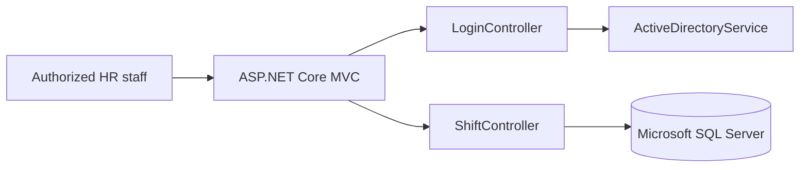

# HRMCutTimeInOut — Employee Shift Management

**ASP.NET Core MVC · C# · SQL Server · Active Directory**


> **ตัวอย่างระบบ HRM สำหรับดูข้อมูลพนักงานและจัดการกะการทำงาน** เชื่อมต่อ Microsoft SQL Server และ Active Directory สำหรับการตรวจสอบผู้ใช้งาน

A business application code sample demonstrating employee shift administration, database access, and enterprise authentication.

**Project status:** Portfolio / development sample. Production deployment, automated test results, and an independent security review have **not** been verified.

---

## Features / ความสามารถในโค้ด

| Area | Implementation |
| --- | --- |
| Employee shift overview | View employee code, name, department, and assigned shift |
| Shift assignment | Add and edit employee shift records |
| Database integration | SQL Server queries and the `GetEmployeeData` stored procedure |
| Enterprise login | Validate submitted credentials through an Active Directory service |
| Web authentication | ASP.NET Core cookie sign-in and sign-out |
| Web interface | MVC controllers, models, and Razor views |

## Architecture



*Overview of code components, not a verified production deployment diagram.*

## Technology stack

| Layer | Technology |
| --- | --- |
| Application | C# / ASP.NET Core MVC |
| Target framework | `net7.0-windows` |
| Database | Microsoft SQL Server |
| Data access | SqlClient and Entity Framework Core packages |
| Authentication | Active Directory integration and ASP.NET Core Cookies |
| User interface | Razor Views and Bootstrap |

## Repository structure

```text
HRMCutTimeInOut/
├── HRMCutTimeInOut/
│   ├── Controllers/
│   │   ├── LoginController.cs
│   │   ├── ShiftController.cs
│   │   └── UserController.cs
│   ├── Services/
│   │   └── ActiveDirectoryService.cs
│   ├── Data/
│   ├── Models/
│   ├── Views/
│   ├── Program.cs
│   ├── Startup.cs
│   └── HRMCutTimeInOut.csproj
└── README.md
```

## Running locally / การทดสอบในเครื่อง

A **Windows development environment**, compatible .NET SDK, separate development SQL Server database (including required schema/stored procedures), and an authorized test directory environment may be needed.

```powershell
git clone https://github.com/pongapla/HRMCutTimeInOut.git
cd HRMCutTimeInOut/HRMCutTimeInOut
dotnet restore HRMCutTimeInOut.csproj
dotnet build HRMCutTimeInOut.csproj
dotnet run --project HRMCutTimeInOut.csproj
```

Use **synthetic employee data and development-only credentials**. These commands are guidance only; passing build/runtime tests have not been independently confirmed for this documentation update.

## Security and maintenance notes

- .NET 7 is **out of support**. Upgrade to a supported version and retest before production use.
- Review endpoint authorization, session security, input validation, exception handling, and database permissions.
- Never publish actual employee data, organization-only source code, internal addresses, or usable credentials.
- Audit the public repository and its Git history for sensitive configuration.
- Remove generated IDE/build artifacts (such as `.vs/`, `bin/`, and `obj/`) from future commits where applicable.
- Ensure code shared from an employer or client is authorized for public publication.

---

### Portfolio highlights

**ASP.NET Core MVC** · **SQL Server integration** · **HR business workflows** · **Active Directory authentication**

Developer: [Kittiphob Maynok](https://github.com/pongapla)